# radiant-thermal

[](https://github.com/aneeshkaravadi/radiant-thermal/actions/workflows/ci.yml)

Does the paint color of an outdoor home battery matter, in dollars? I live in North Texas, where batteries sit outside in summer sun and the grid's prices spike on summer evenings, so I wanted to see whether those two things interact. They do.

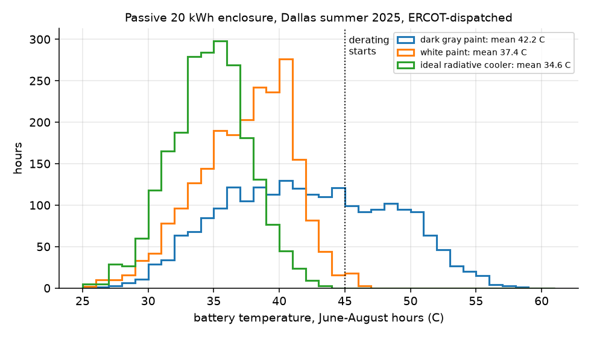

## What I simulated

A generic 20 kWh, 5 kW battery in a passive outdoor enclosure, run through every hour of 2025 in Dallas. All of the inputs are real data:

- **weather:** hourly temperature, dew point, sunlight, wind and cloud cover from Open-Meteo
- **prices:** ERCOT's 2025 day-ahead prices for the North load zone, pulled with gridstatus

Each day a small linear program decides when to charge and discharge to make the most money. The enclosure is a two-node thermal model (the steel skin and the battery inside), and the skin trades heat with the sun, the sky and the air. The cells release their own share of the conversion loss, about 43% of it going by HTW Berlin's lab measurements of home batteries, and the inverter's share heats the skin. When the cells pass 45 °C the battery management system starts cutting power, which means less to sell and less heat, so I go back and forth between the dispatch and the temperatures until no hour asks for more power than its own temperature allows.

## What came out

| Skin | Summer avg cell temp | Hours derated | Aging rate vs 25 °C | 2025 revenue |
|---|---|---|---|---|
| dark gray paint | 42.2 °C | 1,138 | 1.63× | $282 |
| white paint | 37.4 °C | 21 | 1.29× | $319 |
| ideal radiative cooler | 34.7 °C | 0 | 1.15× | $319 |

If the battery never had to derate it would make $319, so the dark box loses about $37 of that and the white box less than a dollar. White paint is worth roughly $37 per battery per year here, plus 21% slower aging, which isn't nothing across a fleet.

Sweeping the absorptance at the same emissivity shows the cost isn't linear. Below white paint the box almost never derates, so going cleaner is worth well under a dollar. Each tenth of solar absorptance costs about $2 a year going darker from white paint, $15 from dark gray and $16 at the black end, because a darker box spends more of its hot hours derated. So dirt that takes a white box from 0.25 to 0.35 costs about $2 and adds 36 derated hours, and the real money is in not being dark.

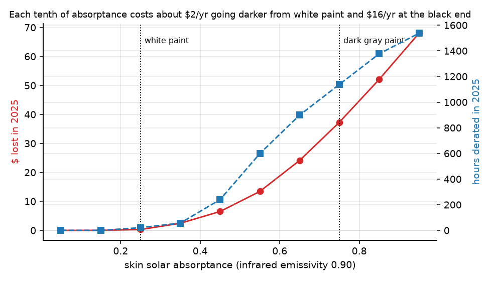

I expected the cells to be hottest exactly when prices peak. They aren't quite. Over the summer, the dark box's cells peak around 4 pm and prices around 8 pm: the battery charges through the morning, the sun heats the box all afternoon, and then it sells into the evening spike. But the cells are still hot when the spike comes. On 78% of summer days the dark box was derated during the day's most expensive hour, and its derated hours averaged $50/MWh against $36 for the summer as a whole.

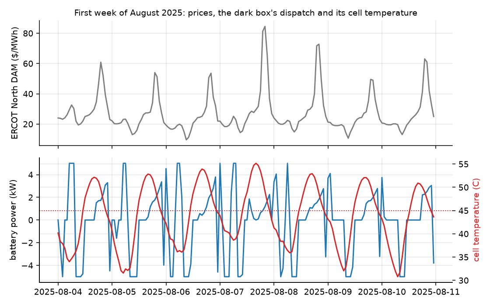

Most of the enclosure is my own assumption: how much of the skin faces the sun, how tightly the cells are coupled to the skin, how much heat the battery stores, how windy it is at the box, and how much of the conversion loss the cells release. So I varied each one over a plausible range, one at a time. White paint's advantage moves between $13 and $67 a year and never changes sign. The biggest by far is how much of the box faces the sun, then how windy it is at the box. My first setup got two of these wrong in opposite directions: putting all of the loss in the cells would alone make it $81, and the convection coefficient that counted radiation twice would alone make it $8.

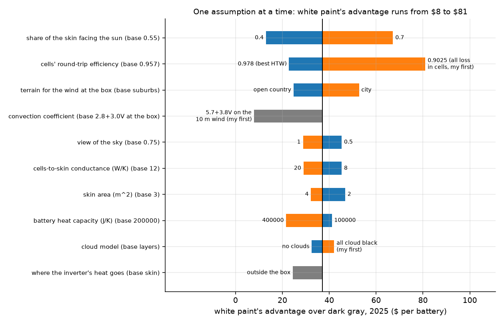

## Checking the sky against measurements

Every enclosure result leans on how much infrared the sky sends back down, and my first cloud model (all cloud black, at air temperature) had never been checked against anything. NOAA's SURFRAD stations measure that downwelling infrared directly, so I took January and July 2025 at Goodwin Creek, Mississippi (humid) and Desert Rock, Nevada (dry) and drove my sky model with Open-Meteo's weather for the same hours (`examples/validate_sky.py`).

Under July overcast my first model read 43 W/m² too high at Goodwin Creek and 72 W/m² too high at Desert Rock, so it understated how well a box can cool to the sky. Low water clouds are warm and nearly black, but thin high cloud is cold and adds much less, so I now treat low, mid and high cloud separately, with their effects fitted on January only. On July, which the fit never saw, it comes within 6 W/m² on average at both sites, with an RMS error of 13 to 14 W/m² against 22 to 26 for the first model. It still reads high under overcast, by 12 and 23 W/m². For the battery, the cloud model matters less than I expected: white paint's advantage is $42 with my first cloud model, $37 with the new one and $33 with no clouds at all.

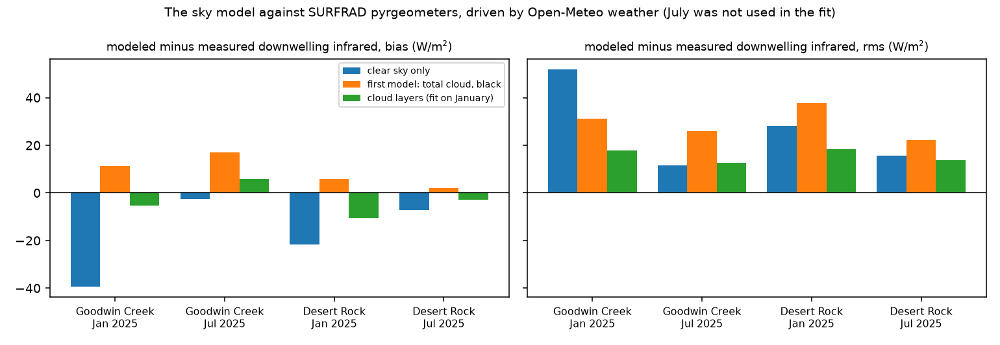

## Dallas vs Houston

I reran everything for Houston with its own 2025 weather and its own ERCOT load-zone prices (`examples/compare_cities.py`). I expected Houston to be easier on the batteries, since its summer air was actually 0.7 °C cooler than Dallas's. For the dark box it wasn't: it derated for 1,231 hours against 1,138 in Dallas, and aged faster too (1.76 against 1.63 times the 25 °C rate).

My first version of this section said the difference was humidity, without testing it. So I swapped one of Dallas's inputs into Houston at a time (dark box, hours derated):

| Houston with Dallas's | nothing | dew point | wind | clouds | air temperature | sunlight | prices |
|---|---|---|---|---|---|---|---|
| hours derated | 1,231 | 1,119 | 1,175 | 1,184 | 1,209 | 1,324 | 1,319 |

Humidity is the biggest single piece. With Dallas's dew point, Houston's box derates 112 fewer hours, more than the whole gap, because water vapor closes the sky's infrared window. Swapping the other way agrees: Dallas with Houston's dew point derates 91 more hours. Houston's lighter wind and its clouds each add about 50 hours, and Dallas's stronger summer sun pulls the other way. The hours hide two things, though. Houston's battery loses less money to derating, $29 against $37, partly because its prices are worth less to a battery to begin with ($290 against $319 with no derating). And Houston's faster aging comes mostly from its warmer year (21.8 °C mean against 20.2 °C), not its humid summer: Dallas's air temperature alone takes Houston's aging rate from 1.76 to 1.67, and Dallas's dew point only to 1.72. A white box barely notices either city, with 9 derated hours in Houston and 21 in Dallas.

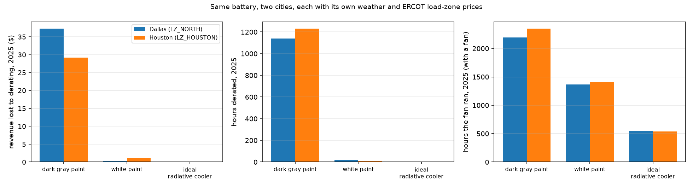

## Once there's a fan

Real units usually have fans, so I added one: about 100 cfm and 30 W. It switches on when the cells pass 35 °C and off below 32 °C, and only while the outside air is cooler than the cells, since blowing hotter air in would heat them up. That changes the answer. Every skin earns the full $319, because the cells almost never reach 45 °C anymore (3 hours for the dark box instead of 1,138). The paint now shows up mostly as fan time. The dark box ran its fan 2,192 hours (66 kWh, $2.63 at the same day-ahead prices), and the white box 1,365 hours (41 kWh, $1.84). White still ages a little slower, at 1.16 times the 25 °C rate against 1.27. In Houston the same fan runs 3% longer for a white box (1,407 hours against 1,365) and 7% longer for a dark one, and the cells age faster too.

I expected the fan to do most of its work at night, cooling the cells down while the air is cool, but it doesn't. In summer the dark box's fan runs mostly from mid-morning into the evening, and only about a fifth of its running is between 9 pm and 9 am.

So the paint matters a lot for a passive box and much less once there's a fan. For a fan-cooled unit, a white skin mostly buys about 38% less fan running.

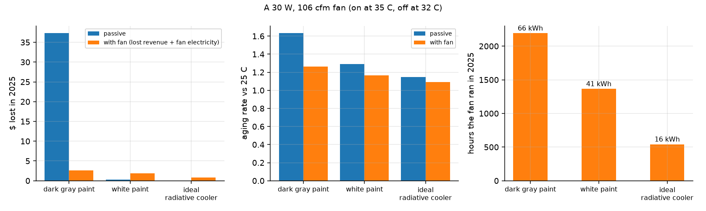

## Wraps and laminates

I also expected that laminating a film or wrap over a white enclosure could help, and mostly it can't. Sunlight that passes through the film bounces between it and the paint, so I summed those bounces as a geometric series. The result is that on an opaque box, only a film that absorbs almost no sunlight beats plain white paint, and anything that absorbs UV or near-infrared makes it worse.

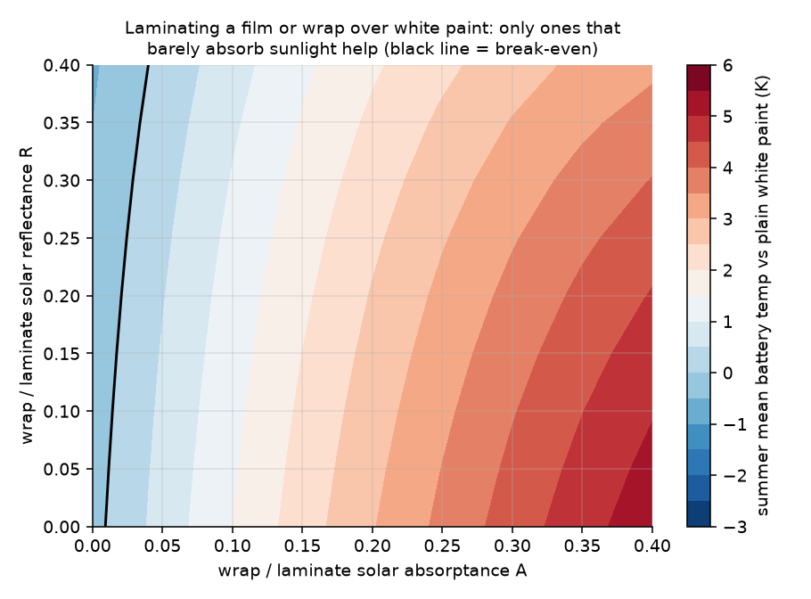

## Emitting only through the window

My skins were gray in the infrared, with one emissivity for every wavelength. But the sky is only partly transparent, mostly between 8 and 13 µm, and a lot of radiative-cooling research is about "selective" emitters that radiate strongly inside that window and reflect everywhere else. So I split the infrared into two bands, the window and everything else. Outside the window I treat the sky as black, and inside it I give the sky whatever emissivity keeps its total radiation equal to the sky model I was already using. That way a gray surface gets exactly the same answer as before, which the tests check, and only selective surfaces change.

A selective version of white paint (0.95 inside the window, 0.10 outside, same solar absorptance) shows the classic trade on the hottest day of 2025. As an insulated surface it gets 3.9 K colder than white paint before sunrise, but 6.5 K hotter in the early afternoon. The battery box is warmer than the air most of the time, so it's on the wrong side of that trade: 45 hours derated against 21 for plain white paint.

The bigger surprise was how wrong the one-band model is for a surface like that. A total-emissivity measurement at room temperature would call the selective coating 0.37, and the gray model with 0.37 says it derates 454 hours, about ten times what the two-band model gives. Knowing only a coating's total emissivity, you can't tell a good selective emitter from a poor emitter.

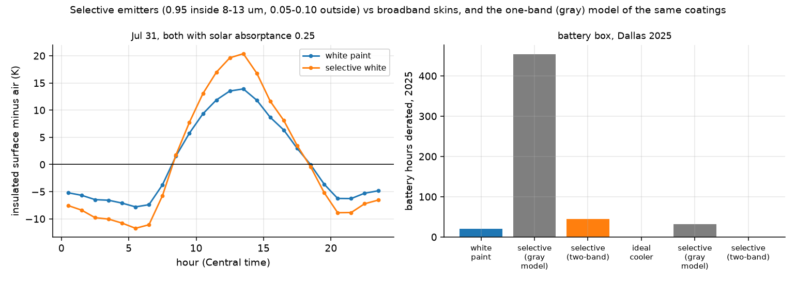

## Same equation, in orbit

A spacecraft radiator is the same energy balance with no atmosphere and no air, just sunlight, Earth's infrared and reflected sunlight coming in against $\varepsilon\sigma T^4$ going out. I use NASA's hot-case design values from the TFAWS environments course (1,423 W/m² of sunlight, albedo 0.27, 260 W/m² of Earth infrared) and fresh coating values from NASA's coatings tables. At 300 K, with the sun 60° off the radiator's normal, an optical solar reflector needs about 4.1 m² per kW, white paint 5.6, and black paint can't get rid of heat at all. Paint darkens in orbit, so those are beginning-of-life numbers.

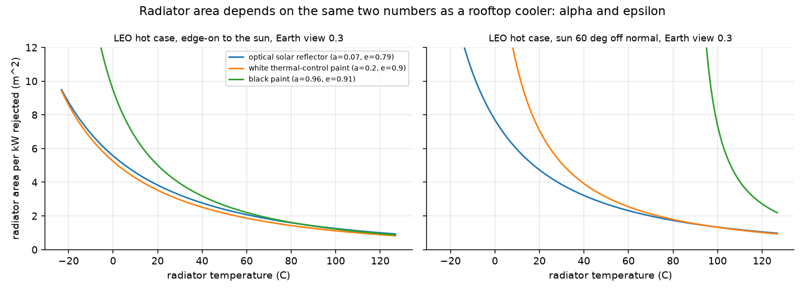

A radiator sized for the hot, sunlit case also has to live through eclipse. At 400 km an orbit takes 92 minutes, and 36 of them are in Earth's shadow, where nothing comes in but Earth's infrared. I followed an optical-solar-reflector radiator sized to reject 1 kW at 300 K in the hot case (4.1 m²) through a few orbits, with the electronics still putting their 1 kW into it in the shadow. It swings 13 K per orbit as a light panel (2 kJ/m²K of heat capacity) and 4 K with ten times that. The shadow geometry and the cooling are both checked against closed forms, and the angle above which the orbit never enters shadow against NASA's number.

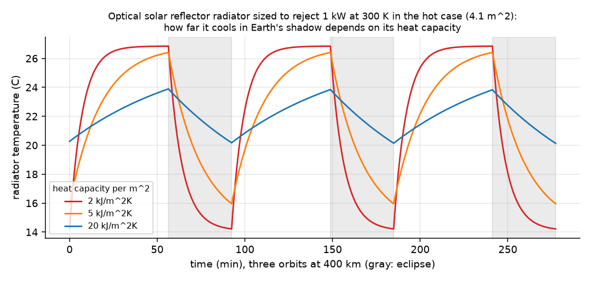

## Mistakes and fixes

- I first pulled the weather in local time while the ERCOT prices came timezone-aware, and around daylight saving those two don't line up hour for hour. Everything is in UTC now, and a test checks the two files match row for row.
- My first pass didn't feed derating back into dispatch, so it counted revenue the battery couldn't actually earn while it was hot.
- My first "energy balance" test only checked that the temperatures came out finite, which doesn't prove anything. I replaced it with one that holds the weather constant and checks that the battery settles exactly where the heat it conducts out equals the heat it generates.
- I applied each hour's sunlight an hour late. Open-Meteo stamps sunlight with the end of the hour it averages but temperature with the instant, and I read both as the start of the hour, which pushed the box's heating toward the evening. A test now checks the sunlight against the sun's position on cloudless days.
- When I did feed derating back, I re-dispatched once and wrote that once was enough. It wasn't: repeating it flips between two schedules, and the one I reported asked for more power than its own temperatures allowed in 182 hours. Now the caps only tighten, and it iterates until every hour fits.
- I put all of the battery's conversion loss into the cells, when the cells release less than half of it, and computed the discharge heat slightly low.
- My convection coefficient, 5.7 + 3.8 times the wind speed, already includes radiation, and I added radiation on top of it. I also fed it the 10 m wind instead of the wind at the box.
- I never checked the cloud part of the sky model. It read 43 to 72 W/m² high under July overcast.
- I wrote that the Houston difference was humidity without testing it. It is the largest piece, but not the whole story, and Houston loses fewer dollars.
- I quoted the cost of a tenth of absorptance at the clean end of the sweep as if it were white paint's, said the cells were hottest exactly when prices peak, called a mean-sunlight case a "hot case" for the radiator, and used an aging activation energy I hadn't sourced.

Fixing the model problems above moved white paint's advantage from $40 to $37 a year, which looks like almost no change, but the pieces moved a lot: the dark box now loses $37 instead of $56, and the white box almost nothing instead of $16.

## Running it

```bash
pip install -e ".[dev]"
pytest -q
python examples/make_figures.py       # a few minutes; --part runs one section at a time
python examples/compare_cities.py
python examples/validate_sky.py
```

The enclosure numbers describe a generic unit, not anyone's product, so the differences between skins are the result, not the absolute temperatures. Assumptions, derivations and sources are in [DERIVATIONS.md](DERIVATIONS.md), and data sources are in [data/README.md](data/README.md).

---

Aneesh Karavadi, dual-enrolled engineering student at UNT through TAMS. Separately from this repo, I'm an undergraduate researcher at UNT, testing transparent UV/IR-blocking radiative-cooling films. A window solar-heat-gain model would be a natural place to apply that kind of film here someday. I used Claude Code to write a lot of the implementation, but the questions and conclusions are mine.
